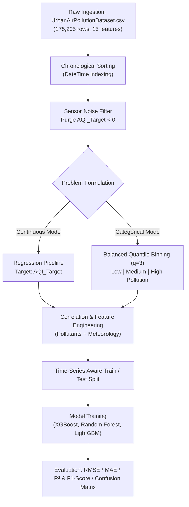

# 🌍 Urban Air Pollution & Air Quality Index (AQI) Prediction System

[](https://www.python.org/)
[](https://pandas.pydata.org/)
[](https://scikit-learn.org/)
[](https://xgboost.readthedocs.io/)
[](https://opensource.org/licenses/MIT)

An end-to-end Machine Learning and environmental data science framework for multi-station urban air quality forecasting. The system integrates high-frequency particulate matter concentrations, gaseous pollutant levels, and meteorological covariates across **175,205 observations** to model continuous **Air Quality Index (`AQI_Target`)** and classify categorical **Relative Pollution Indices**.

---

## 📌 Table of Contents
1. [Project Overview](#-project-overview)
2. [Dataset Architecture & Features](#-dataset-architecture--features)
3. [Data Preprocessing & Quality Assurance](#-data-preprocessing--quality-assurance)
4. [Target Formulations](#-target-formulations)
5. [Pipeline Workflow](#-pipeline-workflow)
6. [Exploratory Data Analysis & Feature Correlation](#-exploratory-data-analysis--feature-correlation)
7. [Modeling & Evaluation Strategy](#-modeling--evaluation-strategy)
8. [Project Structure](#-project-structure)
9. [Installation & Setup](#-installation--setup)
10. [Usage Guide](#-usage-guide)
11. [Roadmap & Future Extensions](#-roadmap--future-extensions)
12. [License](#-license)

---

## 📖 Project Overview

Rapid urbanization and climate volatility have made urban air quality monitoring critical for public health, regulatory compliance, and municipal warning systems. This project implements a robust analytics and predictive modeling engine on multi-year temporal observations collected across **5 distinct monitoring stations**.

### Key Highlights
* **Comprehensive Spatio-Temporal Dataset**: 175,205 entries capturing multi-pollutant interactions and microclimatic weather variables.
* **Rigorous Data Quality Control**: Purges unphysical negative sensor artifacts (`AQI_Target < 0`) caused by instrument baseline drift.
* **Balanced Quantile Classification**: Addresses real-world environmental data skewness by formulating an empirical 3-tier **Relative Pollution Index** (`Low`, `Medium`, `High`).
* **Dual-Target Modeling**: Supports both fine-grained continuous AQI regression and discrete threat-level classification.

---

## 📊 Dataset Architecture & Features

The primary dataset (`UrbanAirPollutionDataset.csv`) contains **175,205 rows and 15 columns** with zero missing values across all sensor channels:

| Column Name | Physical Domain | Data Type | Description |
| :--- | :--- | :--- | :--- |
| `Station_ID` | Spatial Identifier | `int64` | Identifier for the monitoring station (Stations 1 through 5) |
| `DateTime` | Temporal Coordinate | `datetime64` | Timestamp of observation (sorted chronologically) |
| `PM2.5` | Particulate Matter | `float64` | Fine particulate matter $\leq 2.5\,\mu\text{m}$ ($\mu\text{g}/\text{m}^3$) |
| `PM10` | Particulate Matter | `float64` | Inhalable particulate matter $\leq 10\,\mu\text{m}$ ($\mu\text{g}/\text{m}^3$) |
| `NO₂` | Chemical Pollutant | `float64` | Nitrogen Dioxide concentration ($\text{ppb}$ / $\mu\text{g}/\text{m}^3$) |
| `SO₂` | Chemical Pollutant | `float64` | Sulfur Dioxide concentration ($\text{ppb}$ / $\mu\text{g}/\text{m}^3$) |
| `CO` | Chemical Pollutant | `float64` | Carbon Monoxide concentration ($\text{ppm}$ / $\text{mg}/\text{m}^3$) |
| `O₃` | Chemical Pollutant | `float64` | Surface Ozone concentration ($\text{ppb}$ / $\mu\text{g}/\text{m}^3$) |
| `Temp_C` | Meteorology | `float64` | Ambient atmospheric temperature in Celsius ($^\circ\text{C}$) |
| `Humidity_%` | Meteorology | `float64` | Relative atmospheric humidity percentage ($\%$) |
| `Wind_Speed_mps` | Meteorology | `float64` | Wind speed in meters per second ($\text{m}/\text{s}$) |
| `Wind_Direction_deg` | Meteorology | `float64` | Wind direction in compass degrees ($0^\circ - 360^\circ$) |
| `Pressure_hPa` | Meteorology | `float64` | Barometric atmospheric surface pressure ($\text{hPa}$) |
| `Rain_mm` | Meteorology | `float64` | Precipitation / rainfall level ($\text{mm}$) |
| **`AQI_Target`** | **Target (Continuous)** | `float64` | Real-valued Air Quality Index target measurement |

---

## 🧹 Data Preprocessing & Quality Assurance

1. **Temporal Sorting**:
   * Timestamps are converted into strict datetime representations and sorted chronologically:
     ```python
     df['DateTime'] = pd.to_datetime(df['DateTime'], errors='coerce')
     df = df.sort_values('DateTime').reset_index(drop=True)
     ```
   * Enforces sequence fidelity and prevents lookahead bias during training and validation splits.

2. **Negative Value Elimination**:
   * Sensor measurement drifts occasionally produce unphysical negative values (minimum observed: `-8.41`).
   * Filtered out unfeasible observations:
     ```python
     df = df[df['AQI_Target'] >= 0]
     ```

---

## 🎯 Target Formulations

The project accommodates two distinct analytical and predictive operational modes:

### 1. Continuous Regression (`AQI_Target`)
* **Objective**: Predict real-valued numerical AQI directly for precise index tracking.
* **Target Range**: $[0.0, 89.24]$ post-cleaning.

### 2. Relative Pollution Index Classification (`AQI_Category`)
Standard regulatory thresholds (e.g. Good $\leq 50$, Moderate $\leq 100$) produce severe skew in this dataset (73% Good, 27% Moderate, 0% Unhealthy). To build effective predictive models, a **Quantile-Based Discretization ($q=3$)** was engineered:

```python
df['AQI_Category'] = pd.qcut(
    df['AQI_Target'],
    q=3,
    labels=['Low Pollution', 'Medium Pollution', 'High Pollution']
)
```

#### Class Distribution:
* **Low Pollution**: 58,401 samples (33.33%)
* **Medium Pollution**: 58,400 samples (33.33%)
* **High Pollution**: 58,401 samples (33.33%)

This produces an ideally balanced multi-class target representing local relative severity.

---

## 🔄 Pipeline Workflow



---

## 🔍 Exploratory Data Analysis & Feature Correlation

Correlation analyses between numerical features and `AQI_Target` identify dominant pollution drivers and atmospheric interactions:

* **Primary Positive Drivers**:
  * Particulate Matter (`PM2.5` and `PM10`) exhibits strong positive correlation with AQI spikes.
  * Chemical precursors (`NO₂`, `SO₂`, `CO`) correlate directly with combustion and industrial density.
* **Meteorological Dispersion Dynamics**:
  * `Wind_Speed_mps` and atmospheric `Pressure_hPa` act as dispersion drivers, diluting surface pollutant concentration.
  * `Rain_mm` exhibits scavenging effects (wet deposition) that suppress particulate levels.

---

## ⚙️ Modeling & Evaluation Strategy

### Recommended Model Benchmarks
* **Regression**:
  * Baseline: Ridge / Lasso Linear Regression
  * Tree Ensembles: Random Forest Regressor, LightGBM Regressor, XGBoost Regressor
  * Metrics: Root Mean Squared Error (RMSE), Mean Absolute Error (MAE), $R^2$ Score
* **Classification**:
  * Baseline: Multinomial Logistic Regression
  * Tree Ensembles: Random Forest Classifier, XGBoost Classifier
  * Metrics: Macro F1-Score, Precision, Recall, Multi-Class Confusion Matrix

### Time-Series Splitting Strategy
```python
# Chronological 80/20 train-test partition (no random shuffling)
split_idx = int(len(df) * 0.8)
train_df = df.iloc[:split_idx]
test_df = df.iloc[split_idx:]
```

---

## 📁 Project Structure

```text
├── data/
│   └── UrbanAirPollutionDataset.csv   # Primary dataset
├── notebooks/
│   └── air_pollution_analysis.ipynb   # Exploratory data analysis & modeling notebook
├── src/
│   ├── preprocess.py                  # Cleaning, sorting, and quantile categorization
│   ├── features.py                    # Feature scaling and temporal encoding
│   ├── train_regressor.py             # AQI numerical prediction pipeline
│   └── train_classifier.py            # Relative pollution index classifier
├── figures/
│   ├── correlation_heatmap.png        # Feature correlation matrix visualization
│   └── category_distribution.png     # Balanced AQI quantile distribution
├── requirements.txt                   # Dependency definitions
├── LICENSE                            # MIT License
└── README.md                          # Project documentation
```

---

## 💻 Installation & Setup

### Prerequisites
* Python 3.9, 3.10, or 3.11
* `pip` or `conda` package manager

### 1. Clone the Repository
```bash
git clone https://github.com/your-username/urban-air-pollution-prediction.git
cd urban-air-pollution-prediction
```

### 2. Create Virtual Environment
```bash
# macOS/Linux
python3 -m venv venv
source venv/bin/activate

# Windows (PowerShell)
python -m venv venv
.\venv\Scripts\Activate.ps1
```

### 3. Install Dependencies
```bash
pip install -r requirements.txt
```

#### `requirements.txt`
```text
pandas>=2.0.0
numpy>=1.24.0
scikit-learn>=1.3.0
xgboost>=2.0.0
lightgbm>=4.0.0
matplotlib>=3.7.0
seaborn>=0.12.0
jupyterlab>=4.0.0
```

---

## 🚀 Usage Guide

### Running in Google Colab or JupyterLab
1. Open `notebooks/air_pollution_analysis.ipynb`.
2. Upload `UrbanAirPollutionDataset.csv` when prompted or place it in the `data/` directory.
3. Run all cells sequentially to reproduce data cleaning, balanced category generation, and correlation visual analysis.

### Executing via Python Script
```bash
# Preprocess dataset and export cleaned splits
python src/preprocess.py --data_path data/UrbanAirPollutionDataset.csv

# Train AQI continuous predictor
python src/train_regressor.py --model xgboost
```

---

## 🔮 Roadmap & Future Extensions

- [ ] **Spatio-Temporal Deep Learning**: Benchmark Graph Neural Networks (GNNs) paired with LSTM/GRU networks across the 5 monitoring stations.
- [ ] **Real-Time Interactive Dashboard**: Build a Streamlit or Dash frontend for live station switching, real-time AQI prediction, and hazard warnings.
- [ ] **Weather API Integration**: Ingest live meteorological forecast data to provide a 24-hour forward-looking AQI forecast.

---

## 📄 License

This project is licensed under the **MIT License** — feel free to use, modify, and distribute this codebase for academic, research, or commercial purposes. See the [LICENSE](LICENSE) file for complete details.

---

---

# 🚀 LIVE DEPLOYMENT LINK

## 🔗 https://huggingface.co/spaces/syedmuskan03/air-pollution-aqi-predictor

---
